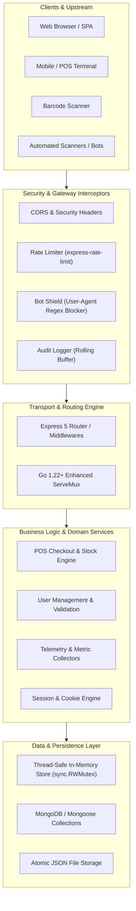

# 🚀 Backend Software Development & Systems Engineering

[](https://go.dev/)
[](https://nodejs.org/)
[](https://expressjs.com/)
[](#-system-architecture)
[](#-module-1-pos-point-of-sale-backend-system-golang)
[](#-author--license)

A comprehensive, production-grade backend engineering repository and monorepo showcasing modern **RESTful API architectures**, **thread-safe concurrent systems**, **real-time observability telemetry**, **POS micro-systems**, **secure session management**, and **cross-language data modeling** across **Go (Golang)**, **Node.js / Express 5**, and **C++**.

---

## 📑 Table of Contents

- [🌟 Monorepo Overview](#-monorepo-overview)
- [🏗️ System Architecture](#️-system-architecture)
- [📂 Repository Map & Project Structure](#-repository-map--project-structure)
- [📦 Core Modules Deep-Dive](#-core-modules-deep-dive)
  - [1. 🛒 POS (Point of Sale) Backend System (`pos-backend/`)](#1--pos-point-of-sale-backend-system-pos-backend)
  - [2. 🛡️ Enterprise Secure API & Live Studio (`API-Part-2/`)](#2-️-enterprise-secure-api--live-studio-api-part-2)
  - [3. ⚡ Real-Time System & PC Observability (`ProcessinPC/`)](#3--real-time-system--pc-observability-processinpc)
  - [4. 📊 User-Agent Analytics & Monitoring (`Agent-Analytics/`)](#4--user-agent-analytics--monitoring-agent-analytics)
  - [5. 🍪 Authentication & Session Architecture (`Cookies_and_Session/`)](#5--authentication--session-architecture-cookies_and_session)
  - [6. 🏛️ Cross-Language Data Modeling & OOP (`Data Modeling Part One/`)](#6-️-cross-language-data-modeling--oop-data-modeling-part-one)
  - [7. 🧮 High-Performance Data Pipelines (`Problem-Practice/`)](#7--high-performance-data-pipelines-problem-practice)
  - [8. 🐹 Standard Library Concurrent REST API (`main.go`)](#8--standard-library-concurrent-rest-api-maingo)
  - [9. 🌐 Modular Routing & Assignments (`part-1-api-routing/`, `AS-1/`)](#9--modular-routing--assignments-part-1-api-routing-as-1)
- [🚀 Quick Start & Installation](#-quick-start--installation)
- [📡 Master API Endpoints Summary](#-master-api-endpoints-summary)
- [🛡️ Production Best Practices & Security Standards](#️-production-best-practices--security-standards)
- [👨‍💻 Author & License](#-author--license)

---

## 🌟 Monorepo Overview

Modern backend systems demand ultra-low latency, thread safety, predictable resource allocation, and robust defense-in-depth security. This repository serves as a hands-on engineering blueprint covering:

1. **High-Performance Go Systems:**
   - Production POS backend with inventory tracking, barcode lookup, and atomic checkout transactions.
   - Clean architecture, zero external framework dependencies, and standard library routing (`net/http` ServeMux enhancements in Go 1.22+).
   - Thread-safe in-memory databases with `sync.RWMutex` preventing race conditions.
2. **Enterprise Node.js / Express 5 Applications:**
   - Layered Controller-Service-Repository MVC architecture with Joi schema validation.
   - Interactive visual analytics and API studio (`/dashboard`) for real-time monitoring and testing.
   - Defense-in-depth: dynamic IP rate limiting, bot & threat filtering (`sqlmap`, `nmap`, automated scrapers), and rolling audit loggers.
3. **Observability & Real-Time Telemetry:**
   - Lightweight GNOME-style system monitor with native Canvas 2D time-series visualization.
   - Microsecond delta CPU rate calculations and granular V8 heap memory telemetry (RSS, Heap, External).
   - Client fingerprinting and automated device/browser analytics with `ua-parser-js` and CSV exports.
4. **State & Data Modeling:**
   - Stateful session authentication with `express-session` and hardened HTTP cookie policies (`httpOnly`, `secure`, `sameSite`).
   - Comparative OOP and data modeling implementations across C++, Go, and JavaScript.
   - High-throughput functional data transformation pipelines (`map`, `filter`, `reduce`, `slice`).

---

## 🏗️ System Architecture

The repository enforces **Clean Architecture** and **Layered Separation of Concerns**, ensuring transport protocols, business rules, and persistence layers remain decoupled and independently testable.



---

## 📂 Repository Map & Project Structure

```plaintext
Backend Software Development/
├── pos-backend/                 # 🛒 Full Go Point-of-Sale (POS) backend system
│   ├── handlers/                # HTTP request controllers (Product, Category, Order, Customer, Report)
│   ├── middleware/              # CORS and request logging middleware
│   ├── models/                  # Domain entities (Product, Category, Customer, Order, Checkout)
│   ├── store/                   # Thread-safe in-memory database with sync.RWMutex & unit tests
│   ├── go.mod                   # Go 1.22 module definition
│   ├── main.go                  # Server bootstrap & router configuration
│   └── README.md                # POS module documentation
│
├── API-Part-2/                  # 🛡️ Enterprise Secure User Management & Interactive Studio
│   ├── controllers/             # User and system controller handlers
│   ├── services/                # Business logic and user data access
│   ├── middleware/              # Rate limiting, bot regex blocking, rolling audit logger
│   ├── public/                  # Built-in visual /dashboard and API studio assets
│   ├── router/                  # Modular express route definitions
│   ├── app.js                   # Application entrypoint (Express 5)
│   ├── package.json             # Express, express-rate-limit, cors, dotenv
│   └── README.md                # Detailed studio and API documentation
│
├── ProcessinPC/                 # ⚡ Time-Series Real-Time System & PC Monitor
│   ├── agent/                   # Background system telemetry sampling agent
│   ├── backend/                 # Telemetry persistence & aggregation APIs
│   ├── frontend/ & public/      # Zero-dependency interactive HTML5/Canvas 2D dashboard
│   ├── docs/                    # Architectural specs and metric documentation
│   ├── app.js                   # Observability server (Express 5 + systeminformation)
│   ├── test-full-system.js      # End-to-end telemetry pipeline test suite
│   └── README.md                # Time-series telemetry documentation
│
├── Agent-Analytics/             # 📊 User-Agent Analytics & Client Monitoring Service
│   ├── controllers/             # Analytics, event, and user controllers
│   ├── middleware/              # ua-parser-js inspection & automated CLI blocking
│   ├── router/                  # Analytics and CSV export endpoints
│   ├── views/                   # Analytics dashboard UI
│   ├── app.js                   # Server entrypoint
│   └── README.md                # Analytics service documentation
│
├── Cookies_and_Session/         # 🍪 Stateful Cookie & Session Authentication
│   ├── app.js                   # Express-session login, protected endpoints & logout
│   ├── appv1.js                 # Session token lifecycle experiments
│   ├── package.json             # express-session, cookie-parser
│   └── README.md                # Cookie security flags and curl walkthrough
│
├── Data Modeling Part One/      # 🏛️ Cross-Language Data Modeling & OOP Architecture
│   ├── dataModal.cpp            # C++: Foundational class modeling
│   ├── Object.cpp               # C++: Multi-entity modeling (Student, Teacher, Product, Book)
│   ├── encapsulation.cpp        # C++: Private encapsulation & BankAccount methods
│   ├── go-oop/                  # Go: OOP via structs, pointer receivers, composition
│   ├── JS/                      # JavaScript: REST API with JSON persistence & frontend UI
│   └── README.md                # Comprehensive OOP & data modeling guide
│
├── Problem-Practice/            # 🧮 High-Performance Data Processing Pipelines
│   ├── filter_out_only_even.js  # Conditional array filtration
│   ├── Map_to_lighter.js        # DTO projection and payload compression
│   ├── Chained_transformations.js # Composed filter-map-sort workflows
│   ├── reduce.js                # Accumulator aggregations and inventory valuation
│   ├── Pagination_with_slice.js # In-memory pagination and page slicing
│   └── README.md                # Backend pipeline patterns & documentation
│
├── part-1-api-routing/          # 🛣️ Modular Route Segregation & Joi Validations
│   ├── app.js                   # Express application wiring
│   ├── user.js                  # User router with Joi validation schema
│   ├── payment.js               # Payment transaction routing
│   └── student.js               # Student management routes
│
├── AS-1/                        # 📝 Blog REST API (Assignment 1)
│   ├── app.js                   # Express application bootstrap
│   ├── blog.js                  # Blog CRUD route handlers
│   └── db.js                    # MongoDB / Mongoose connection layer
│
├── Pricktise-Server/            # 🧪 Hardened Practice Server & Security Auditing
│   ├── controllers/             # User controllers
│   ├── middleware/              # Strict rate limit (2 req/15min) & audit hooks
│   ├── app.js                   # Server entrypoint
│   └── DEPLOYMENT.md            # Production deployment checklist
│
├── main.go                      # 🐹 Core Go In-Memory Thread-Safe Task REST API
├── server.js                    # ⚡ Native Node.js HTTP server demo
├── file.js                      # 📁 Asynchronous File System I/O operations
├── app.js                       # 🔄 Core JavaScript callback & execution flows
└── test.js                      # 🧪 Rapid prototyping & utility test script
```

---

## 📦 Core Modules Deep-Dive

### 1. 🛒 POS (Point of Sale) Backend System (`pos-backend/`)

A production-ready POS backend service written in **Go 1.22+** leveraging enhanced standard library routing, thread-safe memory state management, and real-time inventory deduction.

#### Key Architectural Highlights:
- **Thread-Safe In-Memory Engine:** Employs `sync.RWMutex` to eliminate race conditions across concurrent POS terminal checkouts.
- **Atomic Stock Deduction:** Automatically checks inventory availability, locks resources, deducts stock, and generates an invoice. If any item is out of stock, the transaction is rolled back with an informative error.
- **Barcode Scanner Integration:** Instant $O(1)$ product retrieval by barcode for fast supermarket or retail checkout.
- **Automated Low-Stock Alerts:** Automatically flags products whose stock falls below predefined thresholds (`min_stock`).
- **Loyalty Program & Taxation:** Computes discounts, subtotal, tax amounts, cash change, and adds loyalty points to customer profiles.
- **Order Voiding & Inventory Restoration:** Voiding an order automatically restores item stocks to the inventory.
- **Sales Analytics Dashboard:** Computes daily revenue, total sales count, top products, and low-stock warnings.

#### Project Layout:
```plaintext
pos-backend/
├── go.mod                     # Go 1.22 module
├── main.go                    # Server bootstrap & Go 1.22 ServeMux routing
├── models/models.go           # Product, Category, Customer, Order, Checkout structs
├── store/store.go             # Thread-safe in-memory DB with sync.RWMutex
├── store/store_test.go        # Automated unit tests for checkout & stock
├── handlers/                  # HTTP controller handlers
│   ├── product_handler.go     # Product CRUD & barcode lookup
│   ├── category_handler.go    # Category CRUD
│   ├── customer_handler.go    # Customer management & loyalty points
│   ├── order_handler.go       # POS checkout, invoice lookup & voiding
│   └── report_handler.go      # Real-time analytics dashboard
└── middleware/middleware.go   # CORS & JSON response helpers
```

#### Running & Testing POS Backend:
```bash
cd "pos-backend"

# Run the POS server (default port: 8080)
go run main.go

# Run automated unit test suite
go test -v ./...
```

---

### 2. 🛡️ Enterprise Secure API & Live Studio (`API-Part-2/`)

A hardened, production-grade REST API built with **Node.js** and **Express 5** adhering to layered MVC architecture. Includes a visual **Analytics & Management Studio** available directly at `/dashboard`.

#### Key Features:
- **Interactive Visual Studio (`/dashboard`):**
  - Live charts for traffic volume, client ecosystem distribution, status codes, and latency histograms.
  - Built-in Postman-like API testing suite with pre-configured presets, payload prettifiers, and 1-click execution.
  - Visual User Management directory with interactive modal CRUD actions.
  - Real-time Node.js runtime gauges (RSS memory, heap utilization, process uptime).
- **Defense-in-Depth Security:**
  - **Rate Limiting:** Configurable IP rate limiter (`express-rate-limit`) preventing brute force and scraping.
  - **Automated Bot & Scanner Blocker:** Evaluates client User-Agents against threat regexes (`sqlmap`, `nmap`, `nikto`, `curl`, `python-requests`).
  - **Safe Rolling Audit Logging:** Asynchronous rolling logger storing normalized client records in JSON without blocking the main event loop.
  - **Multi-Method Authentication:** Supports `Authorization: Bearer <token>`, `x-api-key` header, or `?token=<token>` query parameter.

#### Running the Studio:
```bash
cd "API-Part-2"
npm install
npm run dev
# Visit http://localhost:3000/dashboard in your browser
```

---

### 3. ⚡ Real-Time System & PC Observability (`ProcessinPC/`)

A high-frequency, low-overhead system and process observability suite inspired by GNOME System Monitor. Designed specifically for Node.js backend runtimes.

#### Key Features:
- **Zero Heavy Frontend Dependencies:** Interactive time-series visualizer built with pure HTML5, CSS3, and native Canvas 2D.
- **Granular V8 Memory Telemetry:** Tracks Resident Set Size (RSS), Heap Total vs. Heap Used, and External ArrayBuffers.
- **Microsecond Delta CPU Rates:** Calculates actual CPU delta between telemetry samples for Total %, User CPU %, and Kernel System CPU %.
- **Crash & Restart Tracking:** Detects process crashes, PID changes, and server reboots, visually displaying restart boundaries.
- **Atomic Disk Persistence:** Temporary file swap pattern (`.tmp` to `.json`) preventing data corruption during unexpected shutdowns.

#### Running Observability Engine:
```bash
cd "ProcessinPC"
npm install
npm run dev
# Run full end-to-end integration test
npm test
```

---

### 4. 📊 User-Agent Analytics & Monitoring (`Agent-Analytics/`)

A dedicated telemetry and client analytics microservice that tracks, inspects, and audits incoming HTTP traffic in real time.

#### Key Features:
- **Dynamic Device Fingerprinting:** Extracts browser family, OS version, device vendor, and engine details via `ua-parser-js`.
- **Automated Scraper Blocking:** Blocks automated CLI tools (`wget`, `httpie`, `curl`) with `403 Forbidden` and increments threat logs.
- **1-Click CSV Export:** Generates downloadable spreadsheet summaries of all request traffic for auditing.
- **Nodemon Loop Prevention:** Configured `nodemon.json` to ignore telemetry log modifications, avoiding restart infinite loops.

```bash
cd "Agent-Analytics"
npm install
npm run dev
```

---

### 5. 🍪 Authentication & Session Architecture (`Cookies_and_Session/`)

Practical implementations of stateful HTTP session handling, signed cookie verification, and session lifecycle management using `express-session` and `cookie-parser`.

#### Key Concepts Implemented:
- **Cookie Security Attributes:** Demonstrates `httpOnly` (XSS mitigation), `secure` (HTTPS enforcement), and `sameSite: 'strict' | 'lax'` (CSRF defense).
- **Session Lifecycle:** User login authentication, server-side session allocation, session validation on protected routes, and session destruction on logout.

```bash
cd "Cookies_and_Session"
npm install
npm run dev
```

---

### 6. 🏛️ Cross-Language Data Modeling & OOP (`Data Modeling Part One/`)

A comprehensive comparative study demonstrating **Object-Oriented Programming (OOP)**, **Data Modeling**, and **Encapsulation** across **C++**, **Go**, and **JavaScript**:

| Concept | C++ (`Object.cpp`, `encapsulation.cpp`) | Go (`go-oop/main.go`) | JavaScript (`JS/controllers/`) |
| :--- | :--- | :--- | :--- |
| **Encapsulation** | `private` / `public` access specifiers | Exported vs unexported identifiers (Capitalization) | ES6 Classes / Closure scopes |
| **Methods & Behavior** | Class member functions | Functions with explicit Pointer Receivers `(s *Student)` | Prototype methods & arrow functions |
| **Composition** | Class inheritance & composition | Structural embedding / Composition over inheritance | Prototypal delegation & object merging |
| **Memory Model** | Stack vs Heap pointers, manual deallocation | Escape analysis & runtime garbage collection | V8 Garbage Collected Heap |

---

### 7. 🧮 High-Performance Data Pipelines (`Problem-Practice/`)

Optimized, functional array transformation recipes for backend developers processing tabular JSON records:

1. **Filtering by Multi-Criteria (`Filter_by_criteria.js`):** In-stock conditions, pricing thresholds, active record filters.
2. **Lightweight DTO Projections (`Map_to_lighter.js`):** Stripping heavy internal database fields before returning HTTP responses.
3. **Chained Transformations (`Chained_transformations.js`):** Fluent compose pipelines: `filter(...) -> map(...) -> sort(...)`.
4. **Aggregations & Valuations (`reduce.js`):** Inventory valuation, category grouping, and statistical roll-ups.
5. **Memory-Safe Pagination (`Pagination_with_slice.js`):** Slicing large result sets with `page` and `limit` boundaries.

---

### 8. 🐹 Standard Library Concurrent REST API (`main.go`)

Located at the repository root, `main.go` demonstrates building a high-speed RESTful Task API using **pure Go standard library** primitives without third-party frameworks.

- **Routing:** Path parsing and method dispatching via `net/http`.
- **Thread Safety:** `TaskStore` guarded with `sync.Mutex` for safe concurrent reads and writes.
- **HTTP Status Semantics:** Proper status code returns (`200 OK`, `201 Created`, `204 No Content`, `400 Bad Request`, `404 Not Found`).

```bash
# Run the root Go REST API
go run main.go
```

---

### 9. 🌐 Modular Routing & Assignments (`part-1-api-routing/`, `AS-1/`)

- **`part-1-api-routing/`:** Segregates business concerns into individual router modules (`user.js`, `payment.js`, `student.js`) backed by **Joi** schema validation rules.
- **`AS-1/`:** Production assignment implementing a persistent MongoDB/Mongoose blog platform with full CRUD capabilities.

---

## 🚀 Quick Start & Installation

### Prerequisites
- **Go:** `v1.21` or higher ([Download Go](https://go.dev/dl/))
- **Node.js:** `v18.x` or higher ([Download Node.js](https://nodejs.org/))
- **Git:** Installed on your system

### 1. Clone the Monorepo
```bash
git clone https://github.com/aftabfarhanarko/Backend-Golang.git
cd Backend-Golang
```

### 2. Running Go Services

#### A. Run the Complete POS Backend:
```bash
cd "pos-backend"
go run main.go
# Server running at http://localhost:8080
```

#### B. Run the In-Memory Task API:
```bash
# From workspace root:
go run main.go
# Server running at http://localhost:8080
```

### 3. Running Node.js / Express Services

#### A. Enterprise Secure Studio & API:
```bash
cd "API-Part-2"
npm install
npm run dev
# Studio live at http://localhost:3000/dashboard
```

#### B. Real-Time Observability Dashboard:
```bash
cd "ProcessinPC"
npm install
npm run dev
# Access monitor at http://localhost:3000
```

#### C. User-Agent Analytics Service:
```bash
cd "Agent-Analytics"
npm install
npm run dev
# Access analytics at http://localhost:3000
```

---

## 📡 Master API Endpoints Summary

### 🛒 POS Backend API (`:8080`)

| Method | Endpoint | Description | Status Code |
| :--- | :--- | :--- | :--- |
| `GET` | `/health` | System health check | `200 OK` |
| `GET` | `/api/dashboard` | Sales summary, daily revenue & low-stock alerts | `200 OK` |
| `GET` | `/api/products` | Retrieve all products (supports `?q=` and `?category_id=`) | `200 OK` |
| `GET` | `/api/products/low-stock` | List products below minimum stock threshold | `200 OK` |
| `GET` | `/api/products/barcode/{code}` | Retrieve single product via barcode scan | `200 OK` / `404 Not Found` |
| `POST` | `/api/products` | Create a new product | `201 Created` / `400 Bad Request` |
| `PUT` | `/api/products/{id}` | Update existing product details | `200 OK` / `404 Not Found` |
| `DELETE` | `/api/products/{id}` | Remove product from inventory | `200 OK` / `404 Not Found` |
| `GET` | `/api/categories` | Retrieve all categories | `200 OK` |
| `POST` | `/api/categories` | Create a new category | `201 Created` |
| `GET` | `/api/customers` | Retrieve customers (supports search `?q=`) | `200 OK` |
| `POST` | `/api/customers` | Register customer & initialize loyalty points | `201 Created` |
| `POST` | `/api/orders/checkout` | Execute atomic POS sale checkout & stock deduction | `201 Created` / `400 Bad Request` |
| `GET` | `/api/orders` | Retrieve sales orders history | `200 OK` |
| `GET` | `/api/orders/invoice/{invoice}`| Retrieve invoice and printed receipt data | `200 OK` / `404 Not Found` |
| `POST` | `/api/orders/{id}/void` | Void order and automatically restore stock | `200 OK` / `400 Bad Request` |

#### Sample POS Checkout Request:
```bash
curl -X POST http://localhost:8080/api/orders/checkout \
  -H "Content-Type: application/json" \
  -d '{
    "customer_id": 1,
    "customer_name": "Tanvir Ahmed",
    "items": [
      {"product_id": 1, "quantity": 2},
      {"product_id": 2, "quantity": 1}
    ],
    "discount": 5.0,
    "tax_percent": 5.0,
    "paid_amount": 150.0,
    "payment_method": "BKASH"
  }'
```

---

### 🛡️ Enterprise Studio & User API (`:3000`)

| Method | Endpoint | Description | Auth Required |
| :--- | :--- | :--- | :--- |
| `GET` | `/dashboard` | Interactive Web Studio & Live Analytics UI | No |
| `GET` | `/api/health` | Process uptime & V8 memory metrics | No |
| `GET` | `/api/analytics` | Traffic volume, threat blocks & latency distribution | No |
| `GET` | `/api/users` | List users (supports search and pagination) | `Bearer` / `x-api-key` |
| `GET` | `/api/users/:id` | Retrieve single user record | `Bearer` / `x-api-key` |
| `POST` | `/api/users` | Create user with schema validation | `Bearer` / `x-api-key` |
| `PUT` | `/api/users/:id` | Update user record | `Bearer` / `x-api-key` |
| `DELETE` | `/api/users/:id` | Delete user record | `Bearer` / `x-api-key` |

---

## 🛡️ Production Best Practices & Security Standards

1. **Concurrency & Thread Safety:**
   - Always protect shared in-memory state with `sync.Mutex` or `sync.RWMutex`.
   - Never perform lock-copying; pass stores and state via pointers.
2. **Context Deadlines & Graceful Shutdown:**
   - Always propagate `context.Context` to network calls, database queries, and background goroutines.
   - Listen for OS termination signals (`SIGINT`, `SIGTERM`) to flush buffered writes and finish in-flight requests.
3. **Defense-in-Depth Middleware Pipeline:**
   - Apply strict IP rate limiting on public endpoints to neutralize DDoS and brute force attacks.
   - Validate and sanitize all inbound request payloads using strict schemas (**Joi** in Express, struct binding tags in Go).
4. **Resilient Logging & Telemetry:**
   - Use asynchronous, non-blocking rolling buffers for audit logs to prevent disk I/O bottlenecks.
   - Never log sensitive client credentials, secrets, or unmasked credit card numbers.
5. **Secure Cookie Management:**
   - Always configure cookies with `httpOnly: true`, `secure: true` (in production HTTPS), and `sameSite: 'strict'` or `'lax'` to prevent cross-site scripting and request forgery.

---

## 👨‍💻 Author & License

Developed and maintained by **[Aftab Farhan Arko](https://github.com/aftabfarhanarko)**.

Distributed under the **MIT License**. Feel free to use, modify, and extend this repository for your own projects, learning, and production architectures. Contributions and pull requests are warmly welcomed!
